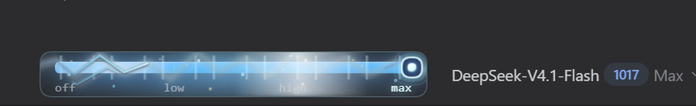

<p align="center">
  
</p>

<h1 align="center">推理强度滑轨 · Reasoning Effort Dock</h1>

<p align="center">
  在 DeepSeek Harness 输入框的模型栏里，加入可拖拽吸附的四档推理强度滑轨。
  <br>
  <a href="README.md">English</a>
</p>

<p align="center">
  <a href="https://github.com/FanXi1230/fanxi/actions/workflows/dsh-reasoning-effort-dock.yml"></a>
  
  <a href="LICENSE"></a>
</p>



## 它做什么

Reasoning Effort Dock 在输入框的模型控件行里加入一条紧凑的滑轨，位置就在模型选择器左侧。它把 DeepSeek 原生的四档推理强度做成吸附式滑轨：

| 档位 | 含义 |
| --- | --- |
| `off` | 关闭推理 |
| `low` | 低推理强度 |
| `high` | 高推理强度 |
| `max` | 最高推理强度 |

- 鼠标拖动滑块、点击轨道或使用方向键均可切换，松手后自动吸附到四个固定档位。
- 右侧模型菜单与滑轨共享同一份真实状态，任意一边切换，另一边都会同步。
- 选中的档位通过 DSH 官方 `session.selectModel({ provider, model, reasoningEffort })` 写入当前会话，影响下一条请求真实使用的推理参数，而不是仅做显示。
- 空白新会话和已有会话都会显示；控件注册在输入框模型行的 `conversation.input.right` 槽位。
- 只有 `max` 档加入蓝白色闪电，同时保留白色横向扫光、细竖条流、漂浮光点、外层光晕和滑块脉冲环；`off` / `low` / `high` 通过填充色渐变和贯穿全档位的虹彩高光保持连续感。
- 裁剪界限是**整个控件模块的圆角边框**：光效可以越过蓝色进度条，但不能画到滑块模块之外。
- `max` 档会周期性出现贯穿整条进度条的**暖金色星光闪光**，与蓝白闪电刻意使用不同颜色。
- 进度条周围加入少量蓝/青色星点，进度条内部也有几颗星尘，和蓝白闪电形成宇宙感，但不会变成五彩缤纷。
- 样式跟随当前 DSH 主题，支持 `prefers-reduced-motion`。

## 环境要求

- DeepSeek Harness Web UI `0.2.1-rc.2` 或同版本线中更新的 `0.2.1` 构建。
- 使用默认 Web profile 自带的 `ui-conversation`、`ui-model-selection` 插件。
- 当前模型必须声明全部四个原生档位。DeepSeek 账号 / API Key 路由满足；其他模型不满足时滑轨自动隐藏。

## 安装

### 从插件市场安装

插件已收录在 [awesome-dsh-plugin](https://awesome-dsh-plugin.com/p/FanXi1230/fanxi--plugins-dsh-reasoning-effort-dock/)。可在 DSH 插件市场 / Discover 页面一键安装，或使用下面的 Release 安装命令。

### 从 GitHub Release 安装

```sh
dsh plugin --profile web add \
  https://github.com/FanXi1230/fanxi/releases/latest/download/dsh-reasoning-effort-dock.tgz
```

如果安装后没有立即出现，重启 `dsh web`。

### 开发时从仓库目录安装

```sh
git clone https://github.com/FanXi1230/fanxi.git
cd fanxi/plugins/dsh-reasoning-effort-dock
node scripts/validate.mjs
```

然后用 DSH 插件管理器添加这个本地包目录，或执行 `dsh plugin --profile <profile> add <package-directory>`。

## 使用

1. 新建会话或打开已有会话。
2. 把滑轨移动到 `off`、`low`、`high` 或 `max`。
3. 发送下一条消息。选中的档位就是该请求使用的推理强度；原生模型菜单会显示同一档位。

档位来源只取当前模型声明的原生四档推理元数据。模型没有完整声明四档时，滑轨隐藏，避免提交不支持的参数。

## 实现方式

这是一个标准 DSH bundle：Host 半侧为空；Client 半侧读取 `ctx.modelDirectories.directoryFor(sessionId)` 的会话模型目录，并调用与 DSH 自己的模型菜单相同的 `directory.select(...)`。插件不额外存会话状态、不发起网络请求、不保存凭据。

MAX 光效层是纯 CSS/SVG，常驻 DOM 并通过透明度交叉淡入淡出；其他档位时暂停动画，所以切换档位不会突然出现或消失。白色扫光、竖条流、光点、光晕和滑块脉冲环都可以越过蓝色进度条，但整个插件根节点使用圆角裁剪，所有元素都不会超出滑块模块的边框。

## 校验

仓库内包含无外部依赖的校验脚本：

```sh
node scripts/validate.mjs
```

它会检查 bundle 清单、patch、模块标识、locale JSON、截图、许可证与 JavaScript 语法。GitHub Actions 在插件目录变更时会运行同一命令。

插件也已在运行中的 DSH Web UI（`0.2.1-rc.2`）上完成实测：

- 新建空白会话会显示 `400 × 38` 的控件；
- 切换到已有会话后控件仍在；
- 用指针把档位切到 `high`，原生模型选择状态同步变为 `High`；再切回 `max` 恢复 `Max`。

## 许可证

本插件使用 [MIT License](LICENSE)。

外层 `fanxi` 仓库有自己的 AGPL-3.0 许可证；本插件位于独立包目录中，并单独使用 MIT。
